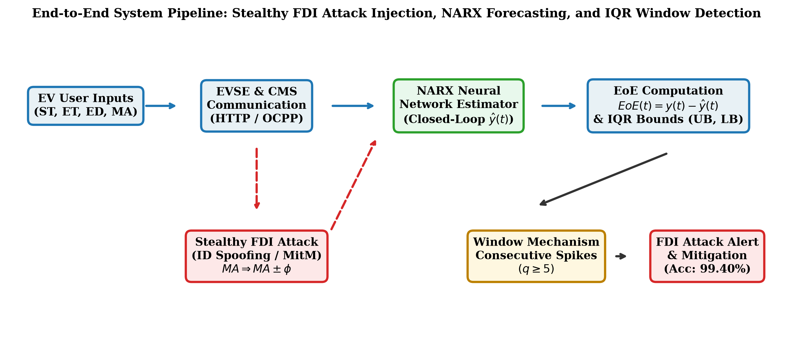
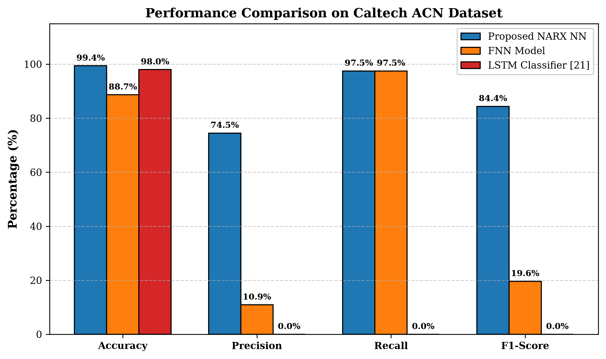
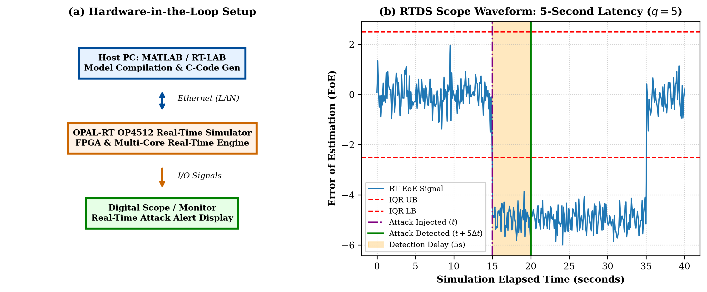

# False Data Injection Attack Detection in EV Charging Network Using NARX Neural Network

[](IEEE_FDI_EV_Charging_NARX.pdf)
[](Overleaf_Project_Team20.zip)
[]()
[]()

> **Course**: Computer Network Security  
> **Team No.**: 20  
> **Faculty Advisor**: Dr. Pradeep Kumar Bhale  
> **Authors**:  
> - **Sumit Kumar** (`CS23B2008`)  
> - **Nisarg Rande** (`CS23B1090`)  
> - **Jatin Goyal** (`CS23B2045`)  
> *Department of Computer Science and Engineering, Indian Institute of Information Technology Design and Manufacturing*

---

## 📌 Project Overview
With the rapid proliferation of electric vehicles (EVs), Internet-of-Things (IoT)-enabled EV supply equipment (EVSE) and Central Management Systems (CMS) have become essential components of smart microgrids. However, standard communication protocols (HTTP, OCPP, IEC 61851 / ISO 15118) lack authenticated cryptographic validation, exposing charging stations to **Stealthy False Data Injection (FDI)** attacks. 

Attackers manipulate user charging duration parameters ($MA \rightarrow MA \pm \phi$) via Man-in-the-Middle (MitM) or Identity (ID) spoofing attacks, causing abrupt charging curtailment and localized grid load imbalances without triggering conventional signature-based alarms.

This repository implements a **model-free, regression-based attack detection framework** using a **Nonlinear Autoregressive Exogenous (NARX) Neural Network** combined with **Interquartile Range (IQR)** statistical thresholding and a consecutive spike window filter ($q = 5$).

---

## 🏗️ End-to-End System Pipeline


1. **User Parameter Input**: Users submit charging preferences ($ST, ET, ED, MA$) via mobile app (HTTP).
2. **Stealthy FDI Manipulation**: Attacker intercepts and perturbs duration ($MA_{t+\Delta t} = MA_t \pm \phi$).
3. **Closed-Loop NARX Forecasting**: NARX model projects expected energy delivery profile $\hat{y}(t)$.
4. **Error of Estimation (EoE)**: Residual is computed as $EoE(t) = y(t) - \hat{y}(t)$.
5. **IQR Statistical Bounding**: Lower ($LB$) and Upper ($UB$) thresholds are established with scale multiplier $\beta = 5.0$.
6. **Consecutive Spike Windowing**: Declares FDI attack if and only if $q = 5$ consecutive spikes exceed IQR boundaries, filtering out normal session transitions.

---

## 📊 Key Results & Comparative Benchmark
Evaluated on **47,095 real-world charging records** from the **Caltech Adaptive Charging Network (ACN-Data)**:

| Performance Metric | Proposed NARX NN | FNN Baseline | LSTM Classifier [21] |
| :--- | :---: | :---: | :---: |
| **Accuracy (%)** | **99.40%** | 88.68% | 98.00% |
| **Precision (%)** | **74.50%** | 10.90% | 0.00% |
| **Recall (%)** | **97.50%** | **97.50%** | 0.00% |
| **F1-Score (%)** | **84.40%** | 19.60% | 0.00% |
| **Mean Squared Error (MSE)** | **$1.997 \times 10^{-5}$** | $1.179 \times 10^{-4}$ | N/A |



> **Key Finding**: Standard ML classifiers (LSTM) fail completely (0% F1-score) due to extreme class imbalance in real charging traces. The proposed NARX regression framework minimizes continuous MSE, remaining completely robust to imbalance.

---

## ⚡ Real-Time Hardware-in-the-Loop (HIL) Validation
Validated on an **OPAL-RT OP4512 Real-Time Digital Simulator (RTDS)** running RT-LAB and MATLAB/Simulink:
* Evaluation stream: 14,129 samples at 1 sample/second.
* Attack injected: Sample 8,000 ($t =$ 2h 13m 20s).
* Attack detected: Sample 8,005 ($t =$ 2h 13m 25s).
* **Deterministic Latency**: Exactly **5 seconds** ($q = 5$ steps).



---

## 📁 Repository Structure
```text
├── IEEE_FDI_EV_Charging_NARX.pdf   # Compiled 5-page IEEE Two-Column Paper
├── Overleaf_Project_Team20.zip     # Complete Overleaf-ready ZIP archive
├── main.tex                        # LaTeX source code (IEEEtran conference class)
├── references.bib                  # BibTeX bibliography database (12 references)
├── images/                         # Publication-grade figures (300 DPI)
│   ├── fig1_flowchart.png          # System architecture & attack flow
│   ├── fig2_attack_iqr.png          # Energy forecasting & IQR spike plot
│   ├── fig3_comparison.png          # Performance comparison bar chart
│   └── fig4_opal_rt.png             # OPAL-RT HIL setup & scope waveform
└── README.md                       # Documentation & project overview
```

---

## 🚀 How to Use / Compile
### Option 1: Overleaf
1. Log in to [Overleaf](https://www.overleaf.com/).
2. Click **New Project** $\rightarrow$ **Upload Project**.
3. Select `Overleaf_Project_Team20.zip` and click **Open**.
4. Set compiler to **pdfLaTeX** and compile `main.tex`.

### Option 2: Local LaTeX
```bash
pdflatex main
bibtex main
pdflatex main
pdflatex main
```

---

## 👥 Authors
* **Sumit Kumar** (`CS23B2008`)
* **Nisarg Rande** (`CS23B1090`)
* **Jatin Goyal** (`CS23B2045`)

**Faculty Advisor**: Dr. Pradeep Kumar Bhale  
*Department of Computer Science and Engineering*  
*Indian Institute of Information Technology Design and Manufacturing*
